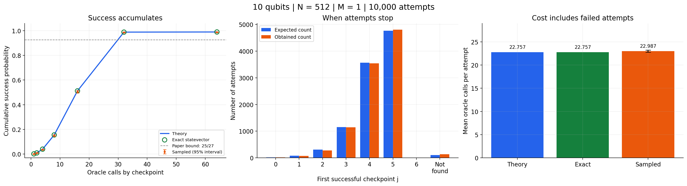

# Fixed-point quantum search

This repository contains code for *Ancilla-mediated fixed-point quantum search
using Grover iterations* by Yash Prabhat, Snigdha Thakur and Ankur Raina.

[Read the paper (PDF)](docs/manuscript-2026-11-11.pdf) |
[arXiv abstract and version history](https://arxiv.org/abs/2608.29839)

The [demonstration notebook](notebooks/fixed_point_search.ipynb) walks through
the search on a simulated quantum register. You can choose the register size,
provide one or more solution states, or try a case with no solutions. It shows
the expected probabilities alongside the statevector and sampled results.
You can read the saved output on GitHub before installing anything.



## Run the notebook

Use Python 3.10 or 3.11. Create a separate environment so these dependencies
do not affect your other projects.

```bash
git clone https://github.com/dubeyPraY/Fixed-Point-Search.git
cd Fixed-Point-Search
python -m venv .venv
```

Activate it on Windows PowerShell:

```powershell
.\.venv\Scripts\Activate.ps1
```

On Linux or macOS:

```bash
source .venv/bin/activate
```

Then install the dependencies and open JupyterLab:

```bash
python -m pip install -r requirements.txt
python -m jupyterlab notebooks/fixed_point_search.ipynb
```

Choose the Python kernel from this environment. Edit the **Your experiment**
cell, then select **Restart Kernel and Run All**. The notebook contains its own
search functions, so you do not need to run the scripts in `Codes/` first.

## Choose an experiment

The default settings are:

```python
TOTAL_QUBITS = 10
SOLUTION_STATES = [37]
SHOTS = 10_000
SEED = 12345
SHOW_CIRCUIT = False
ENGINE = "fast"
```

`TOTAL_QUBITS` includes the flag qubit. Ten total qubits means nine data qubits
and 512 candidates. Set it to 11 if you want ten data qubits and 1024 candidates.

| Setting | What it controls |
|---|---|
| `SOLUTION_STATES` | Decimal indices such as `[5, 37, 127]`, or binary strings such as `["000100101"]`. Use `[]` for no solutions. |
| `SHOTS` | Number of independent search attempts to sample. |
| `SEED` | Random seed for repeating the same sampled experiment. |
| `SHOW_CIRCUIT` | Build and draw the full search circuit when `True`. The default is `False`. |
| `CIRCUIT_DETAIL` | `"compact"` groups each round into a box; `"full"` shows its G and F blocks. |
| `ENGINE` | `"fast"` updates amplitudes directly; `"qiskit"` evolves the gate circuits. |
| `SAVE_RESULTS` | Save CSV tables, figures and a record of the settings when `True`. |

Solution indices must fit the data register. For nine data qubits, they range
from 0 to 511. The notebook prints binary results with qubit 0 on the right.

## How the search works

Ordinary Grover search can overshoot a solution if it runs for too many
iterations. This method adds a flag qubit and checks it between rounds.

Each round applies a chosen number of Grover operations, then the fixed-point
operator F. Measuring flag = 1 means the data register holds a solution and the
search stops. If the flag is 0, the data register returns to the state described
by the angle `2 theta`, up to an overall phase. The next round uses that state.

The Grover counts follow `0, 0, 1, 3, 7, 15, ...`. They are the new operations
in each round, not cumulative counts. The schedule depends on the register
size; it does not need the number of solutions. The simulation knows the
solution list because that list defines the example oracle.

The [paper is available on arXiv](https://arxiv.org/pdf/2608.29839).
The notebook's equation references follow Algorithm 1 and Appendix A of the
manuscript version dated November 11, 2026 used for this implementation.
The [companion guide](Codes/companion.pdf) explains the
notation and gives a small worked example.

## Read the results

The theory column comes from the paper's formulas. The exact simulation
calculates probabilities from the evolved amplitudes and the flag measurements.
The sampled results show the outcomes from the requested number of attempts.

Theory and the exact simulation should agree to numerical precision. Sampled
results fluctuate, including when the seed changes. A 95% confidence interval
can miss the theoretical value in an individual run.

For the saved example with one solution among 512 candidates:

| Quantity | Result |
|---|---:|
| Theoretical success probability | 98.931709% |
| Exact simulated success probability | 98.931709% |
| Sampled successes, seed 12345 | 9,868 / 10,000 |
| Expected oracle calls per attempt | 22.757211 |
| Maximum oracle calls per attempt | 64 |

The [example output folder](examples/default_run/) includes the tables, the
figures, and `run_config.json` with the settings and package versions.
The notebook also plots when attempts stop and which solutions they return.

### Compare with 1.33 epsilon

The notebook includes the paper's approximate `E[Q] = 1.33 epsilon` comparison,
using its Eq. (6) definition of epsilon. In the default experiment, epsilon is
17 and the exact all-attempt mean is `1.338659 epsilon`, about 0.65% above the
`1.33 epsilon` reference.

An analytical sweep at `N = 10^10` shows how the ratio varies. It distinguishes
the M-dependent cutoff in `Codes/make_figures.py` from the implemented search's
fixed N-based schedule. It also shows the successful-event contribution separately
from the mean that includes failed attempts. The 1.33 factor is an approximation,
not a constant enforced by the simulation. This analytical sweep does not
allocate a statevector of that size.

An attempt that reaches the end of the schedule reports "not found". That
does not prove the solution set is empty. With at least one solution, the
paper's ideal completed schedule has a success bound of `25/27`, about 92.59%.
When the supplied solution list is empty, success probability is zero and
every attempt uses the full schedule.

## What the simulation counts

The fast engine works on the full statevector without building large square
matrices. It follows the branch that continues after each failed check and
records the successful branches. It then samples the stopping checkpoint and
data result for each attempt. This gives the same ideal distribution as
evolving every attempt separately, while avoiding repeated calculations.

The Qiskit engine applies the actual gate blocks. Both engines include the
measurement collapse and stop after success. F alone, repeated without those
measurements and stopping decisions, would be a different algorithm.

One G or F counts as one oracle query under the paper's convention. The mean
query count includes failed attempts. It is not a hardware gate count or a
wall-clock speed measurement. The explicit solution-list oracle is useful for
testing the algorithm; a practical problem would need its own reversible
predicate. This demo assumes uniform state preparation and ideal, noiseless
operations.

## Files in this repository

```text
Fixed-Point-Search/
├── README.md
├── LICENSE
├── requirements.txt
├── requirements-dev.txt
├── notebooks/
│   └── fixed_point_search.ipynb
├── examples/
│   └── default_run/
├── tests/
│   └── test_notebook.py
├── tools/
│   └── check_notebook.py
├── docs/
│   └── maintaining.md
├── .github/workflows/checks.yml
└── Codes/
    ├── FOQA_Complexity_corrected.ipynb
    ├── make_figures.py
    ├── theta_emerges.py
    ├── verify_updated.py
    └── companion.pdf
```

`notebooks/` is the starting point for the Qiskit demonstration. `Codes/`
contains the existing research calculations, checks and figure scripts.
These files use the same manuscript version, checkpoint definitions and query
counts as the demonstration notebook.

## Check or reproduce a change

```bash
python -m pip install -r requirements-dev.txt
python -m unittest discover -s tests -v
python tools/check_notebook.py --all-cases
```

The unit tests read the functions from the notebook itself. They check the
gate operators, measurement reset, query costs and edge cases, including a
full 10-qubit comparison between the two engines. The notebook checks execute
the plots, both circuit views and the export option under several settings.
The GitHub Actions workflow runs these commands for pushes and pull requests.

To deliberately refresh the saved default output and example files:

```bash
python tools/check_notebook.py --refresh-example
```

Keep the committed notebook at its default settings so readers have a stable
example to compare against. Local exports go into `notebook_results/`, which
Git ignores. See [maintaining the repository](docs/maintaining.md) for the
suggested update process.

## Paper reference

Yash Prabhat, Snigdha Thakur and Ankur Raina (2026).
*Ancilla-mediated fixed-point quantum search using Grover iterations*.
[arXiv:2608.29839](https://arxiv.org/abs/2608.29839).
[PDF](https://arxiv.org/pdf/2608.29839).
[DOI: 10.48550/arXiv.2608.29839](https://doi.org/10.48550/arXiv.2608.29839).

## Dependencies and license

The tested simulation uses Qiskit 2.6.2, NumPy 2.2.6 and Matplotlib 3.10.9.
`requirements.txt` lists the other dependencies and installs JupyterLab.
You do not need Qiskit Aer, an IBM account or a quantum device to run the demo.

The code uses the repository's [MIT license](LICENSE).
